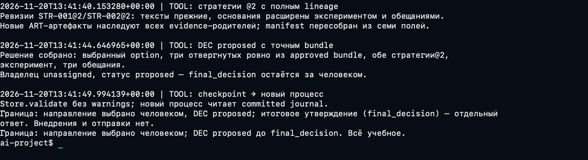

# Стратег с проверяемыми основаниями

**IDE-агент для руководителя цифрового продукта:** уточнить задачу → разобрать
материалы → четыре механизма → две стратегии → план проверки. LLM делает смысловой
анализ; Python CLI извлекает, считает, проверяет ссылки и хранит историю.
**Направление и итоговое решение выбирает человек.**

## v7: полный цикл на примере брифа — telecom, два реальных H

На пользовательском примере брифа (вымышленный оператор, помощь близким и
собственным номерам) кейс прошёл **весь жизненный цикл с настоящими человеческими
решениями**, а не их имитацией:

1. Бриф оцифрован, 6 фактов с дословными цитатами, критерии зафиксированы до скоринга.
2. Четыре механизма (оставить / улучшить / сменить фокус / закрыть) с точной
   арифметикой баллов: **improve 4.00** — лидер во всех наборах весов.
3. **Человек выбрал improve** (сигнал об исчерпании доли + передача одним касанием).
4. Две стратегии с контрактными секциями, три обещания с цитатами брифа,
   опровержимый эксперимент (600 групп, 12%→9%).
5. **Человек утвердил итоговый bundle** → DEC confirmed с digest и ссылкой на одобрение.

- [Итог кейса](demo/telecom-v7/README-V7.md) · [Интегрированная стратегия, 5 частей](demo/telecom-v7/STRATEGY-DOCUMENT.md)
- **[Видео MP4, 42 с](https://github.com/DariaPash/ai-project/releases/download/demo-v7/cli-demo.mp4)** ·
  **[Иллюстрированный PDF, 27 стр.](https://github.com/DariaPash/ai-project/releases/download/demo-v7/description-final.pdf)** ·
  **[Комплект ZIP](https://github.com/DariaPash/ai-project/releases/download/demo-v7/telecom-kit-v7.zip)** ·
  **[Релиз v7](https://github.com/DariaPash/ai-project/releases/tag/demo-v7)**

Экономика (всё учебное): разрыв года 6 млн ₽ = минимум 12 000 доп. оплаченных
номеро-месяцев; сценарии 285,0 / 283,5 / 280,2 млн ₽; разрывы и стоп-условия названы.
Внедрения нет, спрос не измерен — это честный учебный результат.



Запись — реальная PTY-сессия: стратегии@2 с полным lineage, DEC proposed,
checkpoint, чтение новым процессом. Оборванные ошибками сборщика сессии сохранены
как evidence; финальный сегмент подтверждения зафиксирован в Store без монитора
и так обозначен. Не запись IDE и не отдельный модельный контекст.


## v6: прикладной разбор встреч с реальными источниками

[Анализ Otter/Microsoft Learn](demo/applied-v6/README.md) с точными цитатами,
условные стратегии-proposal и 4-минутная запись создания — pre-H сценаарий,
где H остался pending (граница обозначена). Ядро v5 не менялось.

## Как устроен проект

```text
Задача + разрешённые материалы
              ↓
LLM IDE: вопросы → анализ → четыре механизма → две стратегии → план проверки
              ↕
Python CLI: извлечение → расчёты → refs/контракты → журнал/checkpoint
              ↓
Человек: направление, итоговое решение, существенный пересмотр
```

Код — `tools/`, контракты — `schemas/`, роли — `AGENTS.md`/`workflows/`.
Ревьюер: [`agents/reviewer.md`](agents/reviewer.md). Раздельные
[release-gates](workflows/release.md). Источник не может менять инструкции.

## Запуск (только для новой копии)

```sh
python3 -m venv .venv-dev
.venv-dev/bin/python -m pip install -r requirements.txt
.venv-dev/bin/python -m pip install --no-build-isolation -e .
.venv-dev/bin/python -m tools.cli doctor
.venv-dev/bin/python -m tools.cli init --case test-quickstart --namespace test
.venv-dev/bin/python -m tools.cli status --case test-quickstart
```

CPython 3.14.8, macOS arm64, локальный POSIX FS; другая ОС не принималась.
Не переиспользуйте пользовательскую `.venv`. Затем откройте папку в IDE-агенте и
попросите разобрать материалы без выдуманного спроса и решения за вас.

## Проверки, стоимость и границы

- **v7:** 45 контрактных/стратегических тестов; 6 дословных локаторов; сценарии и
  доли — точной арифметикой; PDF 27 страниц (1 713 слов по порядку, все страницы
  растеризованы; визуальный просмотр текущей моделью без зрения недоступен —
  ограничение зафиксировано); MP4 полностью декодирован.
- **История:** v5 — 374 теста в чистой среде; v6 — 45 тестов и публикация с
  анонимной проверкой. Ядро в v7 не менялось.
- Учёт: host сменился на GLM, токен-телеметрия прежнего профиля недоступна —
  фактические расходы unknown, не ноль; потолок $400 — страховка.

Нет сравнительного benchmark, отдельного runtime-ревью v7, реального спроса/эффекта
и полной F01–F15 приёмки. Пример брифа не подтверждает регламент отправки;
видеоплощадка и юридическая отправка капитаном остаются открытыми.
**Конкурс не отправлен.**

История: [v3](https://github.com/DariaPash/ai-project/releases/tag/demo-v3) ·
[v4](https://github.com/DariaPash/ai-project/releases/tag/demo-v4) ·
[v5](https://github.com/DariaPash/ai-project/releases/tag/demo-v5) ·
[v6](https://github.com/DariaPash/ai-project/releases/tag/demo-v6).
V4 содержал ошибку арифметики (исправлена в v5). [Manifest v7](submission/v7/release-manifest-v7.json).
