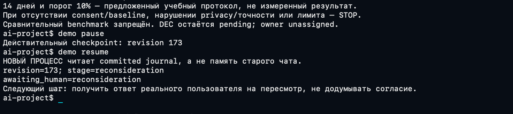
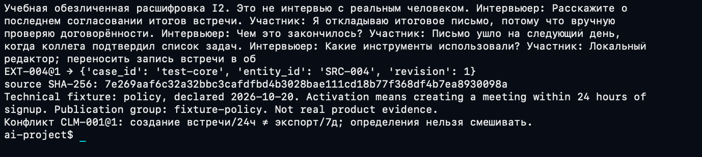
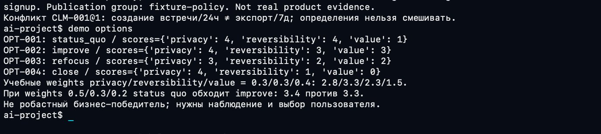
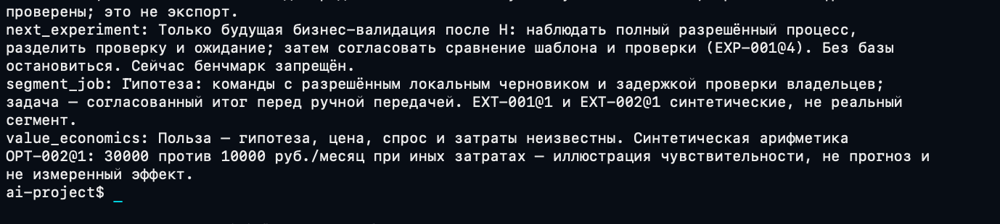
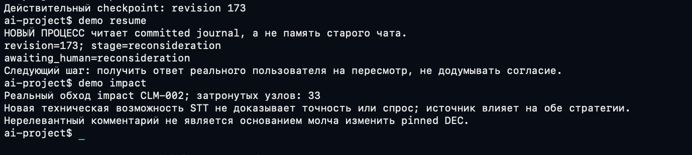

# Стратег с проверяемыми основаниями — v4

**Помощник руководителя цифрового продукта: от разрозненных материалов — к
обоснованным вариантам решения, стратегии и плану проверки гипотез.**

Проект помогает разобраться, что известно о проблеме, каким данным можно доверять,
какие варианты действий есть и что нужно проверить до принятия решения. Результат —
не просто ответ в чате, а сохранённый кейс: источники, расчёты, гипотезы, альтернативы,
две стратегии, ограничения и следующий шаг.

Это переносимая папка IDE-агента, **не автономное приложение и не веб-сервис**.
LLM в IDE выполняет смысловой анализ; Python CLI извлекает материалы, считает
показатели, проверяет структуру и ссылки, сохраняет историю. Решение принимает человек.

## Что делает проект

| Задача | Что получает пользователь |
|---|---|
| Уточнить проблему | Бриф, критичные вопросы, пробелы в данных и критерии выбора |
| Разобрать материалы | Локальные документы и таблицы; ссылки на версии источников, цитаты и координаты |
| Проверить числа | Расчёты воронки, когорт, сегментов, экономики и чувствительности с сохранёнными входами |
| Отделить основания от предположений | Факты, гипотезы, противоречия и ограничения; учебные данные не становятся доказательством спроса |
| Сравнить действия | Четыре класса вариантов: оставить, улучшить, сменить фокус или закрыть; сравнение по явным критериям |
| Подготовить стратегию | Продуктовая и коммуникационная стратегии, обещания и основания, предложение эксперимента |
| Продолжить работу позже | Checkpoint и чтение сохранённого журнала новым процессом, без зависимости от памяти старого чата |
| Учесть новые данные | Поиск затронутых оснований и стратегий; пересмотр передаётся человеку, а не утверждается автоматически |

OCR, локальная расшифровка аудио, обработка видео, filesystem MCP и гибридная память
подключаются отдельно; их доступность зависит от среды и разрешений. Подробности —
в [`integrations/`](integrations/) и [техническом описании](docs/README-build-v4.md).
Проверка структуры данных не равна проверке истинности выводов.

## Как это устроено

```text
Задача + разрешённые материалы
              ↓
LLM в IDE: вопросы → анализ → варианты → стратегии → план проверки
              ↕
Python CLI: извлечение → расчёты → проверка ссылок → журнал и checkpoint
              ↓
Читаемые результаты + основания + неизвестные
              ↓
Человек: выбор направления, согласование решения и пересмотра
```

Инструкции и методики находятся в `AGENTS.md`, `workflows/`, `knowledge/` и `skills/`;
контракты данных — в `schemas/`, реализация CLI — в `tools/`.
Внешние вызовы требуют отдельных разрешений; чужой текст не становится инструкцией.

## Демонстрация: от источников до продолжения работы

**Учебный кейс:** стоит ли улучшать ручную проверку итогов встречи перед передачей
коллегам? Это синтетический пример, а не исследование реальных клиентов.

[](https://github.com/DariaPash/ai-project/blob/main/submission/v4/cli-demo.mp4)

**[Открыть видео в GitHub](submission/v4/cli-demo.mp4)** ·
**[Скачать MP4, 5:04](https://github.com/DariaPash/ai-project/releases/download/demo-v4/cli-demo.mp4)** ·
**[Описание с иллюстрациями, PDF](https://github.com/DariaPash/ai-project/releases/download/demo-v4/description-final.pdf)**

В записи показаны чтение источников и конфликт определений, сравнение четырёх
вариантов, новый отдельный контекст синтеза двух стратегий, сохранение предложений,
checkpoint, продолжение новым процессом и анализ влияния нового основания.
Это настоящая запись терминала (PTY), без озвучки, не экран готового веб-приложения.
Команды `demo …` — вспомогательный сценарий записи; пользовательский интерфейс
проекта — `python -m tools.cli` и инструкции IDE-агенту.

### Скриншоты реального прогона

**Источники и противоречия — 00:16.** Определения активации различаются;
агент сохраняет конфликт, а не смешивает метрики.



**Сравнение вариантов — 00:23.** При изменении весов меняется лидер;
учебная оценка не выдаётся за устойчивый бизнес-выбор.



**Продуктовая стратегия — 04:07.** Польза обозначена гипотезой, цена и спрос
неизвестны, следующий эксперимент требует согласования.



**Продолжение — 04:38.** На превью выше новый процесс читает checkpoint 173;
пересмотр остаётся `awaiting_human`, согласие не додумывается.

**Влияние нового основания — 04:50.** Обход связей показывает затронутые узлы;
техническая возможность STT сама по себе не доказывает точность или спрос.



Скриншоты — неизменённые фрагменты захваченных кадров, не макеты интерфейса.
[Происхождение, таймкоды и SHA-256](demo/screenshots/manifest.json).
Читаемые результаты: [основания](demo/readable-case/evidence.md),
[сравнение вариантов](demo/readable-case/options-comparison.md),
[неизвестные](demo/readable-case/known-unknowns.md).

## Материалы v4

- [Полный комплект с учебным кейсом](https://github.com/DariaPash/ai-project/releases/download/demo-v4/local-demo-kit-v4.zip)
- [Исходники и технические fixtures](https://github.com/DariaPash/ai-project/releases/download/demo-v4/source-kit-v4.zip)
- [Видео, 5:04](https://github.com/DariaPash/ai-project/releases/download/demo-v4/cli-demo.mp4)
- [PDF: 34 страницы, 8 скриншотов](https://github.com/DariaPash/ai-project/releases/download/demo-v4/description-final.pdf)
- [Релиз demo-v4](https://github.com/DariaPash/ai-project/releases/tag/demo-v4)

Те же четыре файла находятся в [`submission/v4/`](submission/v4/).
Хеши — [`submission/v4/release-manifest-v4.json`](submission/v4/release-manifest-v4.json).
Исходники доступны непосредственно в корне; читаемые результаты — в
[`demo/readable-case/`](demo/readable-case/).

Видео — настоящая PTY-запись, не запись рабочего стола: 13 команд, новый отдельный
контекст создаёт две стратегии, Store сохраняет предложения, новый процесс читает
checkpoint. Исторические STT/MCP/Codex-трассы явно отделены от нового выполнения.
Старый одноразовый Codex grant повторно не использовался.

## Быстрый старт исходников

Проверенная среда: CPython 3.14.8, macOS arm64, локальная POSIX filesystem.
Заявленная база Python ≥3.11 не означает приёмку всех версий и ОС.
Не переиспользуйте существующее пользовательское окружение.

```sh
python3 -m venv .venv-dev
.venv-dev/bin/python -m pip install -r requirements.txt
.venv-dev/bin/python -m pip install --no-build-isolation -e .
.venv-dev/bin/python -m tools.cli doctor
.venv-dev/bin/python -m tools.cli init --case test-quickstart --namespace test
.venv-dev/bin/python -m tools.cli status --case test-quickstart
```

Создавайте `.venv-dev` и кейс только при их отсутствии. Установка требует
разрешённой сети; `doctor` не скачивает пакеты и не вызывает модели.
Интеграции подключаются отдельно: [`integrations/bootstrap.md`](integrations/bootstrap.md).
Credentials, пользовательские окружения и machine capabilities не публикуются.

## Восстановление учебного кейса

Скачайте полный комплект, распакуйте в новую папку и откройте `START_HERE.md`.
Команды выполняются из вложенного `project/`, не из исходной машины автора.
Проверенный SHA-256 вложенного `input/backups/demo.zip`:

```text
b2140fc740b6fd38c62f96b8937dd1617f55a821badc3ad91f15cf9ef9873a7f
```

После установки зависимостей:

```sh
python -m tools.cli import-case --case test-core --namespace test --bundle input/backups/demo.zip --trusted-bundle-sha256 b2140fc740b6fd38c62f96b8937dd1617f55a821badc3ad91f15cf9ef9873a7f
python -m tools.cli status --case test-core
```

Используйте Python созданного окружения. Digest — явное доверие только к локальной
обработке собственной синтетики; не разрешение передавать материалы модели или
публиковать свои производные. Исторические rights, namespace и refs сохраняются.
Импорт не перезаписывает существующий кейс.

## Что проверено и что не доказано

- Общий технический прогон: **345 passed**; чистый комплект: ещё **18 passed**,
  editable install, doctor, import, validate, checkpoint, новый процесс и генератор.
- Свежий filesystem MCP bootstrap и настоящий initialize/list/read выполнены.
- Независимое ревью: **acceptable_LOCAL_WITH_EXPLICIT_EXTERNAL_BLOCKERS**;
  [отчёт](submission/v4/final-local-review-reconciled.md).
- **Все данные учебные.** Модельные роли — не клиенты. Реальные спрос, эффект,
  baseline и business-H не установлены; пересмотр остаётся pending.
- Не приняты listening verification STT, другая ОС, качество русского semantic
  retrieval и полный F01–F15 release. Сравнительный benchmark запрещён и не запускался.
- Google Drive не подключён. GitHub-ссылка сама по себе не закрывает требование
  задания о площадке видео. Дополнительный бриф, по сообщению владельца, пока
  не опубликован; это не проверка организатора.

## История и статус

[v3](https://github.com/DariaPash/ai-project/releases/tag/demo-v3) сохранён без изменения
байтов. Внутренние `published=false` и local-only заметки в замороженных архивах v4
относятся к сборке **до этой публикации**; они не переписываются задним числом.
Публичная доступность определяется GitHub и отдельной квитанцией публикации,
а не старым build manifest. Бизнес-согласование и юридическая отправка конкурса
этой публикацией не выполняются: юридически отправляет капитан.

Подробный README состояния сборки сохранён в
[`docs/README-build-v4.md`](docs/README-build-v4.md).
