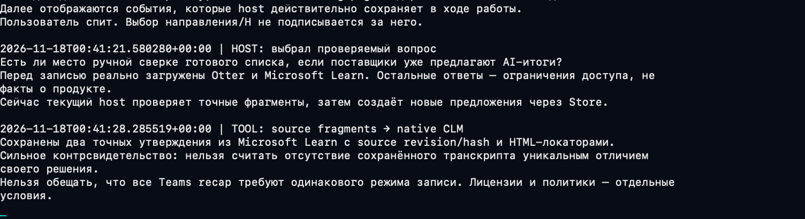
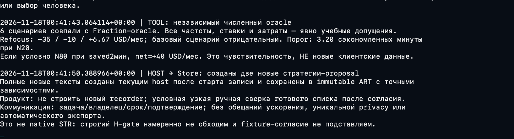
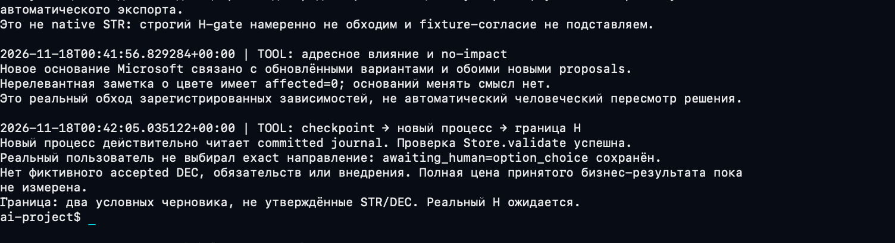

# Стратег с проверяемыми основаниями

**IDE-агент для руководителя цифрового продукта:** помогает уточнить задачу,
разобрать материалы, сравнить четыре направления и подготовить продуктовую и
коммуникационную стратегии. LLM выполняет смысловой анализ; Python CLI извлекает,
считает, проверяет ссылки и сохраняет историю. **Решение принимает человек.**
Это переносимая рабочая папка, не автономное приложение и не веб-сервис.

## Новый прикладной разбор v6

**Вопрос:** стоит ли развивать ручную проверку итогов встреч, если уже существуют
AI-инструменты? В отдельном учебном кейсе текущий LLM-host прочитал реальные
официальные документы, обновил четыре варианта и создал два полных условных
предложения. Их создание и проверки записаны, а не подменены чтением старого ответа.

**Рекомендация: новое решение сейчас не внедрять.** Сначала проверить возможности
уже разрешённых инструментов. Если проблема остаётся — согласовать узкую ручную
сверку готового списка задач: владелец, срок, подтверждение, неизвестное.
Базовая учебная экономика отрицательна; спрос и эффект не измерены.

- [Полный разбор и ограничения](demo/applied-v6/README.md)
- [Продуктовая стратегия — proposal](demo/applied-v6/PRODUCT-STRATEGY.md)
- [Коммуникационная стратегия — proposal](demo/applied-v6/COMMUNICATION-STRATEGY.md)
- [Готовый ручной чек-лист](demo/applied-v6/WORKSHEET.md)
- [Что закрыто по повторному ревью](demo/applied-v6/REVIEW-2-DISPOSITION.md)

### Демонстрация и PDF

**[Видео MP4, 4 минуты](https://github.com/DariaPash/ai-project/releases/download/demo-v6/cli-demo.mp4)** ·
**[Иллюстрированный PDF, 30 страниц](https://github.com/DariaPash/ai-project/releases/download/demo-v6/description-final.pdf)** ·
**[Комплект анализа и медиа ZIP](https://github.com/DariaPash/ai-project/releases/download/demo-v6/applied-analysis-kit-v6.zip)** ·
**[Релиз v6](https://github.com/DariaPash/ai-project/releases/tag/demo-v6)**

Запись показывает реальные события текущего host и инструментов в PTY-мониторе:
источники → CLM → четыре OPT → расчёты → два новых ART-proposal → impact/no-impact →
checkpoint и чтение новым процессом. FIFO-монитор только отображает события;
Python не генерирует стратегию сам. Это **не запись IDE, не новый изолированный
LLM-контекст и не независимое ревью**. Пять fetch-попыток подготовлены до записи
и так обозначены; ожидание не ускорено. Одна команда монитора, семь событий.
Без озвучки. Реальный выбор пользователя остаётся pending.



**Что изменило вывод:** Microsoft Learn описывает отдельный сценарий recap без
сохранения транскриптов при Copilot. Это не уникальное отличие нашего предложения
и не доказательство отсутствия обработки/передачи данных. Otter публикует
транскрипцию и AI workflows. Оба источника — заявления поставщиков, не независимая
проверка качества или спроса. Zoom не проверен; защита и URL-policy не обходились.
[URL, дата и SHA-256](demo/applied-v6/SOURCE-REGISTER.json) ·
[Проверенные локаторы без перепубликации snapshots](demo/applied-v6/CITATIONS.json).



**Две стратегии сохранены как immutable ART-019@1 / ART-020@1**, не как утверждённые
STR. Четыре OPT имеют ревизию 2. Разрешение автономной работы и бюджет не превращены
в согласие на конкретное бизнес-решение; фиктивный H не подставлялся.



Проверен committed checkpoint64. [Происхождение кадров](demo/screenshots-v6/manifest.json).

## Как устроена работа

```text
Задача + разрешённые материалы
              ↓
LLM IDE: вопросы → анализ → четыре механизма → две стратегии → план проверки
              ↕
Python CLI: извлечение → расчёты → refs/контракты → журнал/checkpoint
              ↓
Человек: направление, итоговое решение и существенный пересмотр
```

Локально поддерживаются MD/TXT/text-PDF/CSV/XLSX/HTML, расчёты, цитаты/локаторы,
история, pause/resume и bounded lexical retrieval. OCR/STT/MCP/embeddings и
отдельный reviewer зависят от настройки и разрешений; наличие схем не означает
полной приёмки. Источники не могут менять инструкции. Проверка схем не доказывает
истинность вывода. [Роль ревьюера](agents/reviewer.md) · [Release-gates](workflows/release.md).

## Запуск

Проверенная среда ядра: CPython 3.14.8, macOS arm64, локальный POSIX filesystem.
Python ≥3.11 — заявленная база, не приёмка всех ОС. Host автора: OpenAI/ChatGPT
через OpenCode, `gpt-6.1-sol`; подписка и credentials не поставляются.

Только для новой копии, если окружение и кейс ещё не существуют:

```sh
python3 -m venv .venv-dev
.venv-dev/bin/python -m pip install -r requirements.txt
.venv-dev/bin/python -m pip install --no-build-isolation -e .
.venv-dev/bin/python -m tools.cli doctor
.venv-dev/bin/python -m tools.cli init --case test-quickstart --namespace test
.venv-dev/bin/python -m tools.cli status --case test-quickstart
```

Установка требует разрешённой сети к registry. `doctor` не вызывает модели.
Не заменяйте пользовательскую `.venv`; для существующего кейса начните со `status`.
Затем откройте папку в IDE-агенте и попросите разобрать разрешённые материалы,
сравнить «оставить / улучшить / сменить фокус / закрыть», не выдумывая спрос и
не принимая решение за вас. Служебные refs/revisions обрабатывает агент.
[Подключение компонентов](integrations/bootstrap.md) ·
[Подробный запуск и восстановление синтетического v5](docs/README-v5.md).

## Проверки, стоимость и границы

- **v6:** 45 targeted технических тестов; четыре точные цитаты/локатора, шесть
  численных сценариев с Fraction-oracle, impact/no-impact, validate и новый процесс.
  Полное декодирование MP4; 30 страниц PDF растеризованы, 1 858 слов проверены
  по порядку, исправленная маркировка источников проверена на всех страницах.
  [Технические результаты](demo/applied-v6/TECHNICAL-CHECKS.json).
- **Неизменённое ядро v5:** исторически 374 теста в чистой среде и 53 проверки
  exact ZIP. Это не новый полный прогон v6. [Квитанции v5](submission/v5/checks.json).
- Измеренный текущий host-интервал: **337,75 с / $0,5274192 API-equivalent proxy**.
  Не списание подписки, не cold start; подготовка источников вне интервала,
  время человека и полная цена принятого результата неизвестны.
  [Расчёт и ограничения](demo/applied-v6/ACCOUNTING.json).

ZIP v6 содержит собственный анализ и медиа, **не полный backup нового кейса**:
полные чужие HTML snapshots, private Store, человеческие receipts и credentials
не распространяются. Точное воспроизведение динамических источников из одного
публичного ZIP ограничено. Для кода/старого синтетического кейса сохранён
[проверенный релиз v5](https://github.com/DariaPash/ai-project/releases/tag/demo-v5).
[Manifest v6](submission/v6/release-manifest-v6.json).

Нет сравнительного benchmark, нового независимого runtime review, реального
клиентского спроса/эффекта и полной F01–F15 acceptance. Другая ОС, русский semantic
paraphrase/listening и полная цена полезного результата не приняты. Реальный H,
данные организаторов, предусмотренная видеоплощадка и юридическая отправка капитаном
остаются открытыми. **Конкурс не отправлен; GitHub не заменяет видеоплощадку.**

История сохранена: [v3](https://github.com/DariaPash/ai-project/releases/tag/demo-v3),
[v4](https://github.com/DariaPash/ai-project/releases/tag/demo-v4),
[v5](https://github.com/DariaPash/ai-project/releases/tag/demo-v5).
V4 содержит известную ошибку арифметики; исправление — в v5. V6 добавляет новый
прикладной разбор, а не переименовывает синтетический demo173.
