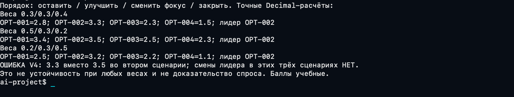
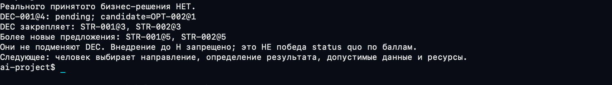
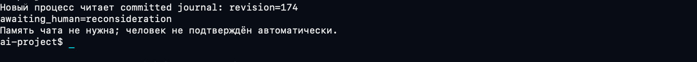

<!-- Archived v5 README; relative links adjusted for docs/ location. -->
# Стратег с проверяемыми основаниями

**IDE-агент для руководителя цифрового продукта: от материалов и вопросов — к
обоснованным альтернативам, двум стратегиям и плану проверки.** Не автономное
приложение и не веб-сервис: LLM анализирует, Python CLI извлекает, считает,
проверяет ссылки и сохраняет историю. Бизнес-решение принимает человек.

> **Исправления v5 по внешнему ревью.** В v4 была ошибка: при весах
> 0,5 / 0,3 / 0,2 improve получает **3,5**, не 3,3. Заявленная смена лидера
> неверна. Здесь — исправленные код, демонстрация и сводка. v3/v4 сохранены как
> история, но их спорные кадры/PDF/модельное объяснение не являются актуальным выводом.

## Начать работу

Проверенная среда: **CPython 3.14.8, macOS arm64, локальный POSIX filesystem**.
Host LLM в работе автора — **OpenAI/ChatGPT через OpenCode, `gpt-6.1-sol`**.
Наличие подписки/квоты и доступ к этой модели на другой установке не гарантируются.
Python ≥3.11 заявлен как база, не приёмка всех версий и ОС. Windows и сетевые
filesystems не приняты. Credentials и окружение автора не поставляются.

Для локального ядра ключи и модельные API-вызовы не нужны. Установка требует
разрешённой сети к registry. Для смыслового анализа нужен отдельно настроенный
LLM-host; модельные вызовы расходуют его подписку/квоту или оплачиваются провайдеру.
OCR/STT/MCP/embeddings — отдельные опциональные компоненты, не скрытые требования.

Из новой копии репозитория, **только если окружение и кейс ещё не созданы**:

```sh
python3 -m venv .venv-dev
.venv-dev/bin/python -m pip install -r requirements.txt
.venv-dev/bin/python -m pip install --no-build-isolation -e .
.venv-dev/bin/python -m tools.cli doctor
.venv-dev/bin/python -m tools.cli init --case test-quickstart --namespace test
.venv-dev/bin/python -m tools.cli status --case test-quickstart
```

Не переиспользуйте существующую пользовательскую `.venv`. Если кейс есть —
начните со `status`, а не повторного `init`. `doctor` ничего не скачивает и не
вызывает модели. [Подключение опциональных компонентов](../integrations/bootstrap.md).

Затем откройте папку в IDE-агенте и напишите, например:

> Работаем в test-quickstart. Помоги проверить, стоит ли улучшать ручную проверку
> итогов встречи. Пока используй только мои локальные учебные материалы, без сети
> и платных вызовов. Уточни до трёх вопросов, способных изменить выбор. Сравни
> оставить / улучшить / сменить фокус / закрыть. Не выдумывай спрос и не выбирай за меня.

Это запрос LLM, а не команда автоматического agent loop. После ответов агент
сохраняет бриф и основания через CLI. Служебные JSON, refs и свежие revisions
обрабатывает агент; пользователю не нужно искать их вручную.

- **«Остановись»** — агент сохраняет проверенное и checkpoint, фиксирует один следующий шаг.
- **«Продолжи test-quickstart»** — читает committed status/handoff, а не память старого чата.
- **«Измени ограничение: …»** — проверяет влияние, создаёт новые предложения; существенное решение снова требует согласия.

Это правила работы IDE-агента, не кнопки отдельного приложения. Результаты своего
кейса — в `cases/<id>/output/`, состояние — в его `handoff.md`; журнал — источник
истины. Готовый учебный пример можно прочитать без запуска: **[сводка для руководителя](../docs/DEMO-SUMMARY.md)**.

## Что делает проект

| Задача | Результат |
|---|---|
| Уточнить проблему | Вопрос решения, критерий полезного ответа, данные/ограничения и явные неизвестные |
| Разобрать материалы | Локальные MD/TXT/text-PDF/CSV/XLSX/HTML; сохранённые bytes/hash, цитаты и локаторы |
| Проверить числа | Воронка, когорты, сегменты, экономика и чувствительность с закреплёнными входами |
| Различить основания | Факты, гипотезы, контрсвидетельства; синтетика не превращается в доказательство спроса |
| Сравнить альтернативы | Оставить, улучшить, сменить фокус, закрыть; критерии и веса до выбора |
| Подготовить стратегии | Продуктовая и коммуникационная STR, обещания/основания и proposal эксперимента |
| Продолжить или пересмотреть | Checkpoint/новый процесс, влияние новых оснований на обе стратегии, отдельный H на существенную правку |

```text
Задача + разрешённые материалы
              ↓
LLM IDE: вопросы → анализ → варианты → две стратегии → план проверки
              ↕
Python CLI: извлечение → расчёты → ссылки/контракты → журнал/checkpoint
              ↓
Человек: выбор направления, согласование решения и пересмотра
```

Код — `tools/`, контракты — `schemas/`, инструкции — `AGENTS.md`, `workflows/`,
`knowledge/`, `skills/`. Отдельная роль ревьюера — [`agents/reviewer.md`](../agents/reviewer.md).
Источник не может менять инструкции. Schema validation проверяет структуру,
не истинность вывода. [Раздельные release-gates](../workflows/release.md).

## Исправленная демонстрация v5

**[Видео MP4](../submission/v5/cli-demo.mp4)** ·
**[Скачать видео](https://github.com/DariaPash/ai-project/releases/download/demo-v5/cli-demo.mp4)** ·
**[Иллюстрированный PDF](https://github.com/DariaPash/ai-project/releases/download/demo-v5/description-final.pdf)** ·
**[Релиз v5](https://github.com/DariaPash/ai-project/releases/tag/demo-v5)**

Новая настоящая PTY-запись: чтение **сохранённого синтетического** checkpoint,
правильный пересчёт, разделение DEC/новых STR, экономическая схема, черновики
сообщений, lexical retrieval, checkpoint и продолжение новым процессом.
**Новой модельной генерации в ролике нет**; это исправление технической демонстрации,
не повторный независимый reviewer-run. Без озвучки; не запись рабочего стола.
Команды `review …` — вспомогательный сценарий записи, не новый продуктовый CLI.

[](https://github.com/DariaPash/ai-project/blob/main/submission/v5/cli-demo.mp4)

**Правильная чувствительность:** улучшить лидирует в трёх заданных сценариях.
Это не доказательство спроса или устойчивости при любых весах.



**Актуальность:** принятого реального решения нет. DEC-001@4 остаётся pending
и ссылается на STR@3; более новые STR@5 не перепривязывают решение молча.



**Продолжение:** новый процесс читает журнал; business-H остаётся pending.
Скриншоты — реальные захваченные кадры, не макеты.
[Таймкоды и hashes](../demo/screenshots-v5/manifest.json).

## Скачать и восстановить учебный кейс

- [Полный комплект v5](https://github.com/DariaPash/ai-project/releases/download/demo-v5/local-demo-kit-v5.zip)
- [Исходники и тесты v5](https://github.com/DariaPash/ai-project/releases/download/demo-v5/source-kit-v5.zip)
- [Manifest v5](../submission/v5/release-manifest-v5.json)
- [Основания с цитатами](../demo/readable-case/evidence.md) · [Сравнение вариантов](../demo/readable-case/options-comparison.md)
- [Результат и ограничения для руководителя](../docs/DEMO-SUMMARY.md) · [Ответ на каждый пункт ревью](../docs/REVIEW-FOLLOWUP.md)

В полном комплекте откройте `START_HERE.md`; команды выполняются из `project/`.
SHA-256 вложенного `input/backups/demo.zip` (исходный checkpoint173 v4, не новая
согласованная стратегия):

```text
b2140fc740b6fd38c62f96b8937dd1617f55a821badc3ad91f15cf9ef9873a7f
```

После установки используйте Python своего окружения:

```sh
python -m tools.cli import-case --case test-core --namespace test --bundle input/backups/demo.zip --trusted-bundle-sha256 b2140fc740b6fd38c62f96b8937dd1617f55a821badc3ad91f15cf9ef9873a7f
python -m tools.cli status --case test-core
```

Импорт не перезаписывает кейс. Внешний digest разрешает только локальную обработку
точной собственной синтетики; не наследует права на модель, публикацию и расходы.
В `docs/DEMO-SUMMARY.md` — новое исправленное пояснение, не переписанная история.

## Проверки, ограничения и сдача

Технические проверки и результаты текущего прогона — в
[`submission/v5/checks.json`](../submission/v5/checks.json). Это не benchmark,
не новое независимое ревью и не полная F01–F15 acceptance.
Исторические v4: 345 технических тестов и 18 clean-kit проверок; эти счётчики
не выдаются за результат проверки новых bytes.

| Реализовано в ограниченном контуре | Экспериментально | Не подтверждено |
|---|---|---|
| Локальные источники/расчёты, refs/журнал, pause/resume, текстовые контракты, полный bounded lexical, явные H/публикационные gates | English hybrid memory, host dispatch/reviewer, OCR/STT/video, filesystem MCP: зависят от установки и отдельных probes | Реальный спрос/эффект, русский semantic paraphrase, listening STT, другая ОС, выигрыш маршрутизации, полная цена пригодного результата, весь F01–F15 |

Индексы до v5 требуют явного rebuild: fingerprint теперь учитывает chunker.
Без доступной модели используйте lexical; автоматического платного rebuild нет.

Все 18 источников demo173 синтетические; реальное внешнее исследование не
выдумывается. Полная цена результата и время человека неизвестны. Ведётся
отдельный API-equivalent учёт разработки — это не цена бизнес-результата и не
фактическое списание подписки. Сравнительный benchmark запрещён и не запускался.

**Конкурс ещё не отправлен:** GitHub не заменяет предусмотренную заданием
площадку видео. Google Drive/Яндекс Диск/VK Видео/RuTube/YouTube, применимость
дополнительного брифа и юридическая отправка капитаном остаются отдельными шагами.

Исторические [v3](https://github.com/DariaPash/ai-project/releases/tag/demo-v3) и
[v4](https://github.com/DariaPash/ai-project/releases/tag/demo-v4) не перезаписываются.
**V4 содержит известную ошибку арифметики в ролике/PDF/кадре options**; для текущего
вывода используйте v5. Исторический README сборки — [здесь](../docs/README-build-v4.md).
